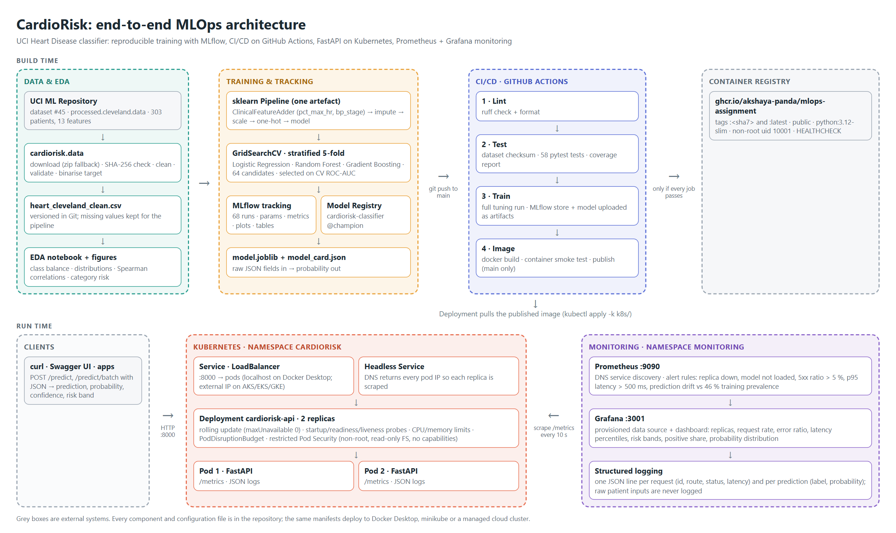

# CardioRisk: heart disease risk prediction with an end-to-end MLOps pipeline

[](https://github.com/Akshaya-Panda/MLOPS-Assignment/actions/workflows/ci.yml)

A binary classifier that predicts the presence of heart disease from 13 clinical measurements
(UCI Heart Disease, Cleveland subset), delivered as a monitored, containerised API on Kubernetes.
Every stage runs from code in this repository: data acquisition, EDA, training with experiment
tracking, testing, CI/CD, container publishing, deployment and monitoring.

> Coursework for BITS Pilani *Machine Learning Operations (AIMLCZG523)*, Assignment 1.
> The model is for education only and is not a medical device.



## Results

Models were tuned with a grid search scored by stratified 5-fold cross-validation on 80 % of the
data. The champion was chosen on **mean CV ROC-AUC only**, so the 20 % hold-out test set stays an
unbiased final check.

| Model | CV ROC-AUC | CV accuracy | CV recall | Test ROC-AUC | Test accuracy | Test recall | Test precision |
|---|---|---|---|---|---|---|---|
| **Logistic Regression** (champion) | **0.909 ± 0.016** | 0.859 | 0.819 | 0.957 | 0.869 | 0.929 | 0.813 |
| Random Forest | 0.894 ± 0.021 | 0.818 | 0.774 | 0.944 | 0.885 | 0.893 | 0.862 |
| Gradient Boosting | 0.883 ± 0.025 | 0.818 | 0.765 | 0.958 | 0.902 | 0.929 | 0.867 |

Champion: elastic-net logistic regression (`C=1.0`, `l1_ratio=0.5`, `class_weight="balanced"`).
On the test set it misses 2 of 28 patients with disease (recall 0.93). Its cross-validated train/validation
ROC-AUC gap is the smallest of the three (0.93 vs 0.91), whereas the forest overfits (0.98 vs 0.89).

## Repository layout

```
cardiorisk/            ML package: config, data, eda, features, evaluation, train, predict
app/                   FastAPI service: schemas, Prometheus metrics, JSON logging
notebooks/01_eda.ipynb executed EDA notebook (uses cardiorisk.eda)
data/processed/        cleaned dataset (raw file is downloaded, SHA-256 verified)
models/model_card.json metadata of the exported champion (model.joblib is built by training)
reports/               EDA summary, model comparison, figures
tests/                 58 pytest tests (data, features, model/training, API)
Dockerfile             serving image (python:3.12-slim, non-root, healthcheck)
.github/workflows/     CI/CD: lint -> test -> train -> build, smoke-test, publish image
k8s/                   Deployment, LoadBalancer + headless Services, ConfigMap, PDB (kustomize)
monitoring/            Prometheus config + alert rules, Grafana provisioning + dashboard, k8s manifests
scripts/               smoke_test.sh, k8s_deploy.sh, generate_traffic.py
tools/                 screenshot capture (web UIs and real terminal output)
docs/                  architecture diagram source
screenshots/           evidence for the report
```

## Quick start

Requirements: Python 3.11 or 3.12, Git, Docker. Kubernetes (Docker Desktop, minikube or a cloud
cluster) is needed only for the deployment step.

```bash
git clone https://github.com/Akshaya-Panda/MLOPS-Assignment.git
cd MLOPS-Assignment
python -m venv .venv
source .venv/bin/activate            # Windows (Git Bash): source .venv/Scripts/activate
pip install -r requirements.txt
export MLFLOW_DISABLE_AGENT_HINT=1
```

### 1. Data and EDA

```bash
python -m cardiorisk.data            # download (zip fallback), verify SHA-256, clean, save CSV
python -m cardiorisk.eda             # figures -> reports/figures/, summary -> reports/eda_summary.json
python -m nbconvert --to notebook --execute --inplace notebooks/01_eda.ipynb
```

Source: [UCI Machine Learning Repository, Heart Disease (id 45)](https://archive.ics.uci.edu/dataset/45/heart+disease),
licensed CC BY 4.0. The cleaned file is committed at `data/processed/heart_cleveland_clean.csv`.

### 2. Train, track and register

```bash
python -m cardiorisk.train           # ~2 min: 64 grid candidates, MLflow logging, registry, export
python -m cardiorisk.predict --input sample_request.json
mlflow ui --backend-store-uri sqlite:///mlflow.db --port 5000    # http://127.0.0.1:5000
```

### 3. Tests and lint

```bash
ruff check . && ruff format --check .
pytest --cov=cardiorisk --cov=app
```

### 4. Run the API in Docker

```bash
docker build -t cardiorisk-api:1.0.0 .                    # after training (needs models/model.joblib)
docker run -d --name cardiorisk-api -p 8000:8000 cardiorisk-api:1.0.0
bash scripts/smoke_test.sh http://127.0.0.1:8000          # health, ready, predict, 422, metrics
```

Or pull the image CI published: `docker run -p 8000:8000 ghcr.io/akshaya-panda/mlops-assignment:latest`.

### 5. Deploy to Kubernetes with monitoring

```bash
bash scripts/k8s_deploy.sh                       # API + Prometheus + Grafana on the current context
python scripts/generate_traffic.py --duration 300   # optional: load for the dashboards
```

| Endpoint | URL (Docker Desktop) |
|---|---|
| API docs (Swagger) | http://127.0.0.1:8000/docs |
| Prometheus | http://127.0.0.1:9090/targets |
| Grafana dashboard (read-only, no login) | http://127.0.0.1:3001 |

Grafana admin password: `kubectl -n monitoring get secret grafana-admin -o jsonpath='{.data.password}' | base64 -d`.

On **minikube**: `minikube start`, then `minikube tunnel` in a second terminal (LoadBalancer IPs),
then run the deploy script. To use a locally built image instead of ghcr.io:
`minikube image load cardiorisk-api:1.0.0 && IMAGE=cardiorisk-api:1.0.0 bash scripts/k8s_deploy.sh`.

> On Windows use `127.0.0.1` rather than `localhost`: `localhost` resolves to IPv6 first and every
> request then waits about 2 s before falling back.

## API

`POST /predict` takes one patient (UCI Cleveland encoding). `ca` and `thal` are optional and
imputed by the pipeline if missing. Unknown fields and out-of-range values are rejected with 422.

```bash
curl -s -X POST http://127.0.0.1:8000/predict -H "Content-Type: application/json" -d @sample_request.json
```

```json
{"prediction": 1, "label": "heart_disease", "probability_disease": 0.9974, "confidence": 0.9974,
 "risk_band": "high", "model_version": "logistic_regression-v1", "request_id": "5e04bb4f..."}
```

| Endpoint | Purpose |
|---|---|
| `POST /predict` | one patient: prediction, probability, confidence, risk band (low < 0.3 ≤ moderate < 0.6 ≤ high) |
| `POST /predict/batch` | up to 100 patients |
| `GET /health` | liveness (process up) |
| `GET /ready` | readiness (model loaded; 503 otherwise) |
| `GET /model-info` | model card: version, parameters, metrics |
| `GET /metrics` | Prometheus metrics |
| `GET /docs` | interactive Swagger UI |

## Design decisions

**Data.** The raw file is pinned by SHA-256, so every run trains on byte-identical input. Missing
values (6 cells in `ca`/`thal`) and physiologically impossible readings are left as `NaN` in the
cleaned CSV and imputed *inside* the model pipeline, fitted on training folds only, to avoid leakage.

**Features.** Nominal codes (`cp`, `restecg`, `slope`, `thal`) are one-hot encoded and numeric
features standardised. Two clinically motivated features are engineered in a custom transformer:
`pct_max_hr = thalach / (220 - age)` (share of age-predicted maximum heart rate, separating
age from exercise capacity) and `bp_stage` (ACC/AHA 2017 resting blood-pressure category). Feature
engineering, preprocessing and the estimator form one sklearn `Pipeline`, so training, evaluation,
the CLI and the API apply identical transformations.

**Models and selection.** A linear baseline (elastic-net logistic regression) is compared with two
tree ensembles. Tuning uses `GridSearchCV` with five metrics recorded and `refit="roc_auc"`. ROC-AUC
is threshold-independent and robust to the mild class imbalance (46 % positive); recall is reported
alongside because a missed diagnosis costs more than a false alarm.

**Experiment tracking.** MLflow (SQLite backend) holds one parent run per model family (best
parameters, CV mean ± std and test metrics, ROC/PR/confusion/permutation-importance plots, CV
results table, serialised model with signature and input example). Each grid candidate is a nested
child run (64 in total), plus a model-selection run. The champion is registered as
`cardiorisk-classifier` with the alias `champion`. MLflow stores the models in the skops format
(no arbitrary pickle code), with only our own transformer and sklearn's tree structure explicitly
trusted. The API loads the same pipeline from `models/model.joblib`.

**Serving.** FastAPI with Pydantic validation derived from the same plausibility rules as the data
cleaning. One uvicorn worker per container, so Prometheus metrics in process memory are correct; the
service scales with replicas. Logs are JSON lines. Prediction logs record outcomes, never patient inputs.

**CI/CD.** Four chained jobs: a failure stops the pipeline with GitHub-annotated logs, and each job
uploads its outputs (test reports, model + MLflow store, Docker logs). The image is published to
GitHub Container Registry only from `main` and only after it passes a live container smoke test.
Runners are pinned to `ubuntu-24.04`.

**Deployment.** Two replicas with zero-downtime rolling updates, startup/readiness/liveness probes,
resource requests and limits, a PodDisruptionBudget and the *restricted* Pod Security Standard
(non-root, read-only root filesystem, all capabilities dropped). The LoadBalancer service is
published on localhost by Docker Desktop and receives an external IP on AKS/EKS/GKE.

**Monitoring.** Prometheus discovers every replica through the headless service's DNS (no
Kubernetes API permissions needed) and evaluates five alert rules: replica down, model not loaded,
5xx ratio > 5 %, p95 `/predict` latency > 500 ms, and a drift signal on the share of positive
predictions against the 46 % training prevalence. Grafana is provisioned as code with the data
source and a 14-panel dashboard. Anonymous users get read-only access, and the admin password is a
generated Kubernetes Secret.

## Reproducibility

- Pinned dependencies (`requirements.txt`, `requirements-serve.txt`), fixed seeds, checksum-verified data.
- Training on the lab machine (Linux, Python 3.12) and on a Windows laptop (Python 3.11) produced identical
  CV and test metrics, and the CI runner retrains from scratch on every push.
- `model_card.json` records the data hash, git commit, library versions and MLflow run id of the
  exported model.

## Screenshots

All under `screenshots/`, generated by `tools/capture_screenshots.py` (web UIs) and
`tools/capture_terminal.py` (real command output):

| Area | Files |
|---|---|
| MLflow | `mlflow_01` … `mlflow_11`: runs, nested grid search, champion run, plots, comparison, registry |
| API | `api_01` … `api_04`: Swagger, live `/predict` call, model info, metrics |
| Tests / Docker | `tests_01`, `docker_01`, `docker_02` |
| CI/CD | `github_01` … `github_07`: run history, pipeline graph, every job, published package |
| Kubernetes | `k8s_01` … `k8s_04`: cluster, rollout, LoadBalancer requests, monitoring namespace |
| Monitoring | `grafana_01`, `grafana_02`, `prometheus_01` … `prometheus_03` |

## Limitations

303 patients from a single hospital (Cleveland, 1988) is a small, dated sample, so the test metrics
carry wide uncertainty (61 test patients). The positive class merges disease severities 1–4.
Fairness across sex and age groups was not evaluated. The drift alert watches the prediction mix
only, not the input feature distributions.
